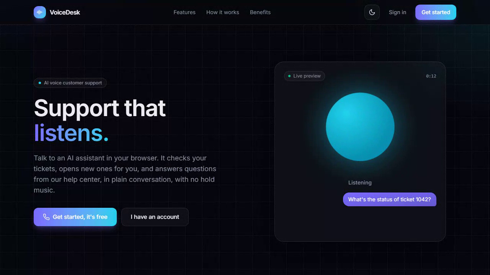
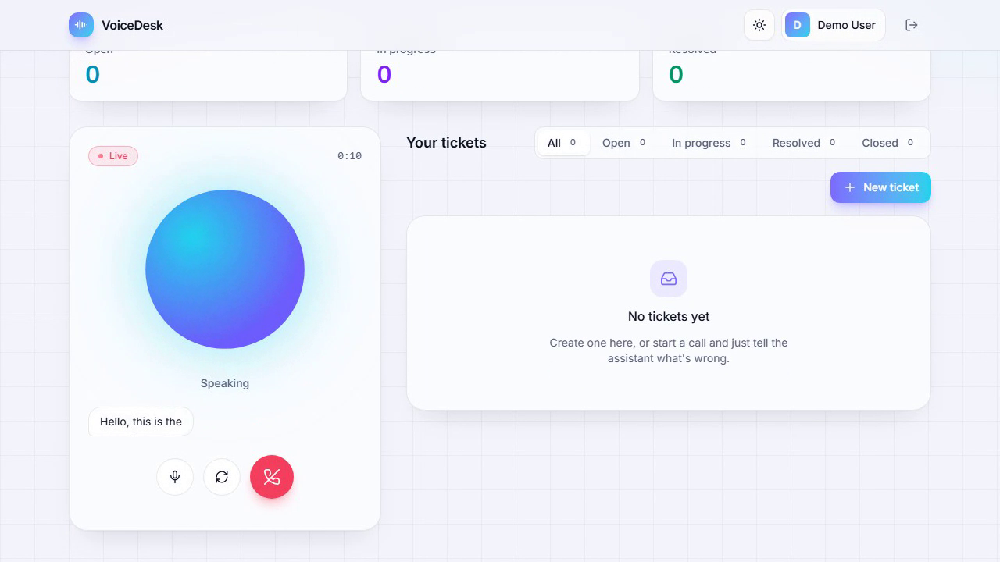
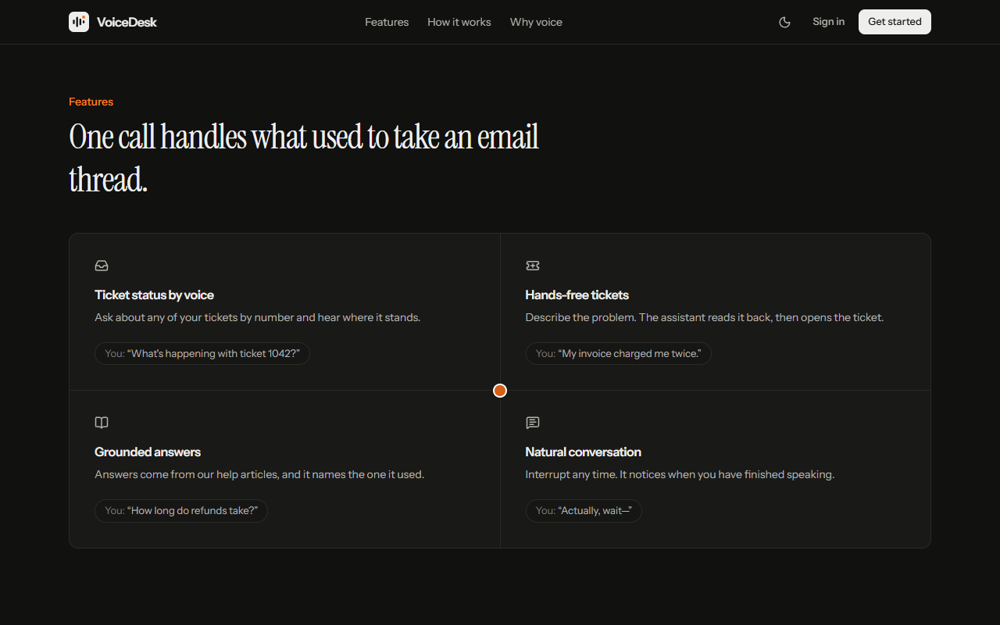

# VoiceDesk

**A voice-first AI customer-support platform.** Customers talk to an AI assistant in the browser. The assistant can look up their tickets, open new ones, and answer how-to questions from the help center, and it only ever sees the caller's own data.

## Demo

[](docs/media/voicedesk-demo.webm)

**▶ [Watch the demo video](docs/media/voicedesk-demo.webm)** (22 seconds, WebM, no sound)

The video walks through the whole product, uncut:

1. The landing page in dark mode, with its preview of a call.
2. Signing up through the dialog.
3. The dashboard, then switching to light mode.
4. Starting a call. The real voice agent joins and greets the caller ("Hello, this is the VoiceDesk…"), and the orb follows its voice.
5. Ending the call.

It was recorded automatically with Playwright using a simulated microphone, so the assistant greets but there is no spoken conversation. The pause after the call connects is the agent starting up (about 9 seconds), which is on the [roadmap](docs/roadmap.md) to shorten.

| A live call: the assistant speaking | The landing page's feature overview |
| --- | --- |
|  |  |

## What's new

| Change | Details |
| --- | --- |
| **Landing page** | Visitors first see what VoiceDesk is, how to use it and its benefits, with **Sign in** and **Get started** in the header. Signing in opens as a dialog over the page. |
| **Light and dark themes** | Follows your OS on the first visit, remembers your choice, and applies it before the page draws (no flash). Switching animates as a circle growing from the toggle. |
| **Refreshed app UI** | Sticky top bar, greeting with live ticket stats, filter tabs, and a call panel with a live timer and a real mute button. Respects reduced-motion settings. |
| **Usage limits** | 3 calls per user per day, 30 calls per day site-wide, 10-minute maximum call length, and per-IP limits on sign-up and login, so a public link cannot drain the LiveKit credit. |
| **Production deployment setup** | One-command Docker stack: Caddy (automatic HTTPS, strict security headers) in front of the web app and API, PostgreSQL on a private network, and the voice agent in production mode. Tested end to end locally. |
| **Demo video** | A recorded walkthrough of the whole product (above). |

## What it does

- **Real-time voice calls** over WebRTC (LiveKit Cloud). The animated orb reacts to the actual audio level and shows whether the assistant is listening, thinking or speaking.
- **An AI support agent** (speech-to-text → LLM → text-to-speech) that can be interrupted mid-sentence and detects when you have finished speaking.
- **Tool calling with real authorization.** The agent checks ticket status by spoken number ("ticket 1042"), lists your tickets, and creates tickets after reading them back to you. It acts *as the caller*, enforced by the API rather than the LLM.
- **Help-center answers (RAG)** grounded in the knowledge base, with the source article named, and an "I don't know, shall I open a ticket?" fallback when nothing relevant is found.
- **A ticket REST API** with validation, ownership rules, keyset pagination and idempotent creation.
- **Accounts:** scrypt password hashing and revocable sessions, with customer and support-agent roles.
- **Abuse and cost protection:** daily call limits per user and site-wide, a maximum call length, and rate-limited sign-up and login.
- **A modern web app:** a landing page, light and dark themes, and an audio-reactive voice orb, with accessibility built in.

## Architecture


The API owns all data and every authorization decision. The agent never touches the database; it calls the API with a service key plus the LiveKit room name, and the API acts as the user that room was created for. See [docs/architecture.md](docs/architecture.md) for the request flows.

## Tech stack

| Layer | Technology |
| --- | --- |
| Language | TypeScript (strict) everywhere |
| Frontend | React 19, Vite 7, Tailwind CSS 4, Motion, LiveKit React components |
| API | Node.js 24, Express 5, Zod 4 |
| Database | PostgreSQL 17 (Docker), Prisma 7 with the `pg` driver adapter |
| Voice | LiveKit Cloud (WebRTC), LiveKit Agents for Node.js |
| AI models | Via LiveKit Inference: Deepgram Nova-3 (STT), GPT-4.1 mini (LLM), Deepgram Aura-2 (TTS) |
| Retrieval | PostgreSQL full-text search, measured with an evaluation set |
| Logging | pino structured JSON logs with request IDs |
| Tests | Vitest and Supertest against a real test database |
| Deployment | Docker Compose, Caddy 2 (automatic HTTPS), one AWS Lightsail server (planned) |

## Repository layout

```text
voicedesk/
├── apps/
│   ├── api/          Express REST API, Prisma schema & migrations, help-center articles (+ Dockerfile)
│   ├── agent/        LiveKit voice agent and its tools (+ Dockerfile)
│   └── web/          React frontend (+ Dockerfile that builds it into a Caddy image)
├── deploy/           Caddyfile and the production .env template
├── docs/             Project documentation (start at docs/README.md)
├── docker-compose.yml       Local PostgreSQL for development
├── docker-compose.prod.yml  Full production stack on one server
└── package.json      npm workspaces
```

## Quick start

You need Node.js 24, Docker Desktop and a free [LiveKit Cloud](https://cloud.livekit.io) project. The full walkthrough is in [docs/getting-started.md](docs/getting-started.md).

```powershell
npm install
docker compose up -d --wait                      # PostgreSQL on localhost:5432

# Configure apps/api/.env and apps/agent/.env from their .env.example files, then:
cd apps/api;   npx prisma migrate deploy; npx prisma generate; npm run kb:ingest

# One terminal each:
cd apps/api;   npm run dev                        # http://localhost:4000
cd apps/agent; npm run dev                        # registers with LiveKit Cloud
cd apps/web;   npm run dev                        # http://localhost:5173
```

Run the tests with `npm test` in `apps/api` (against a separate `voicedesk_test` database) and in `apps/agent`.

## Deployment

The whole product runs on a single server with Docker:

```text
Internet ─HTTPS─▶ Caddy (automatic Let's Encrypt certificate, security headers)
                    ├─ /        → React app (static build)
                    └─ /api/*   → Express API ─▶ PostgreSQL (private network only)
                  Voice agent (production mode) ─▶ LiveKit Cloud
```

```bash
cp deploy/.env.example deploy/.env    # set DOMAIN, generated secrets, LiveKit keys
docker compose -f docker-compose.prod.yml --env-file deploy/.env up -d --build
```

On start, the API applies database migrations and loads the help articles. Only ports 80 and 443 are exposed. The site sends a strict Content-Security-Policy (scripts only from its own origin) and allows the microphone only for itself. HTTPS is required because browsers only allow microphone access on secure pages.

The stack has been tested end to end locally: HTTPS, sign-up, a live LiveKit call under the security policy with zero violations, the call limits, and IP-spoofing resistance of the rate limits. Hosting on AWS Lightsail (one 2 GB server, about $12 per month) is the next step.

## Documentation

| Document | What it covers |
| --- | --- |
| [Getting started](docs/getting-started.md) | Prerequisites, environment variables, running every part locally, scripts |
| [Architecture](docs/architecture.md) | Components, request flows, data model |
| [API reference](docs/api.md) | Every endpoint, request and response shapes, error codes |
| [Security](docs/security.md) | Authentication, authorization, agent delegation, secrets, privacy |
| [Voice agent](docs/voice-agent.md) | Pipeline, tools, models, costs, reliability |
| [Knowledge base](docs/knowledge-base.md) | Ingestion, retrieval, evaluation, known limits |
| [Design decisions](docs/decisions.md) | Key trade-offs, and what would change them |
| [Status and roadmap](docs/roadmap.md) | What is done, known issues, what is next |

## License

To be added (MIT is planned).
