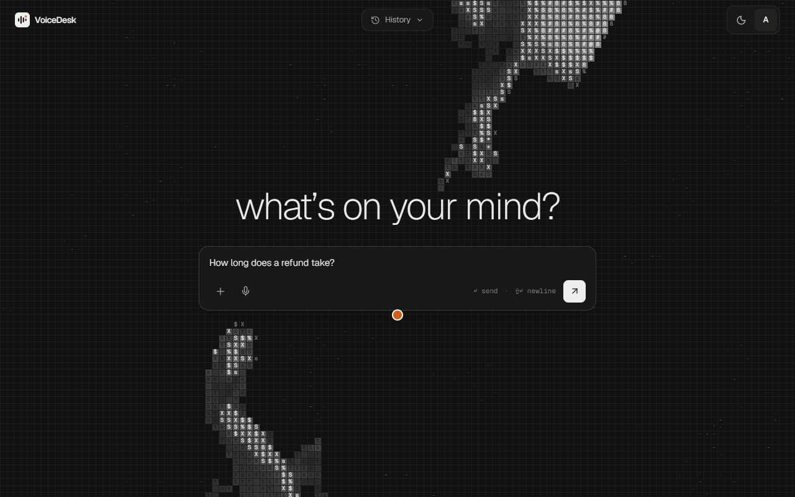
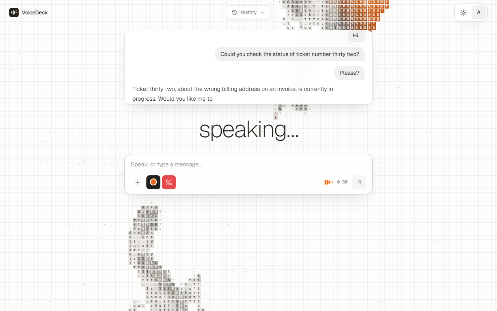
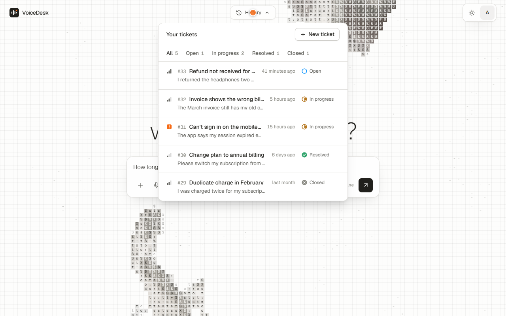
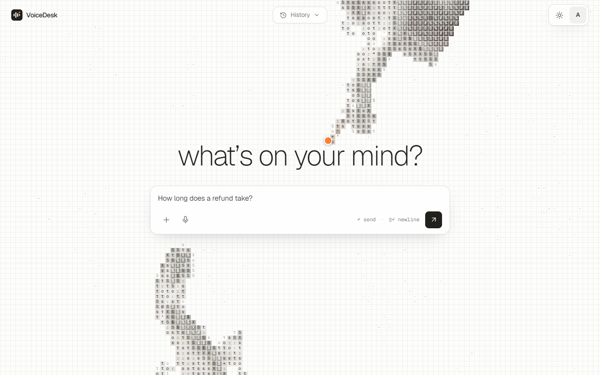
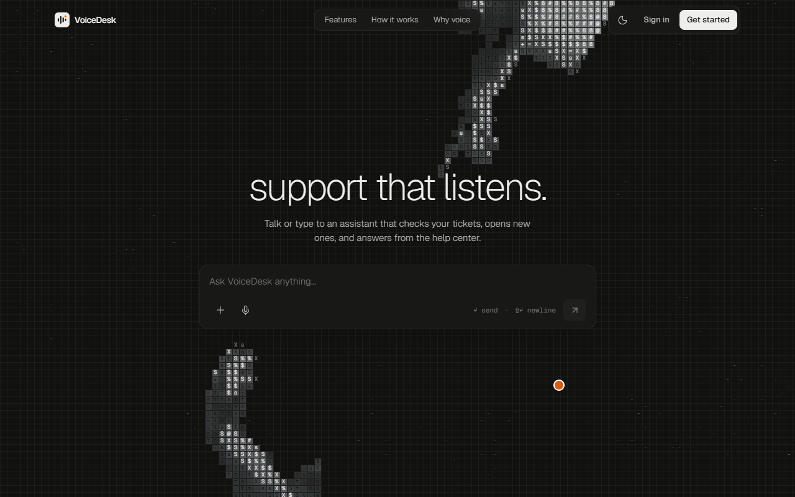
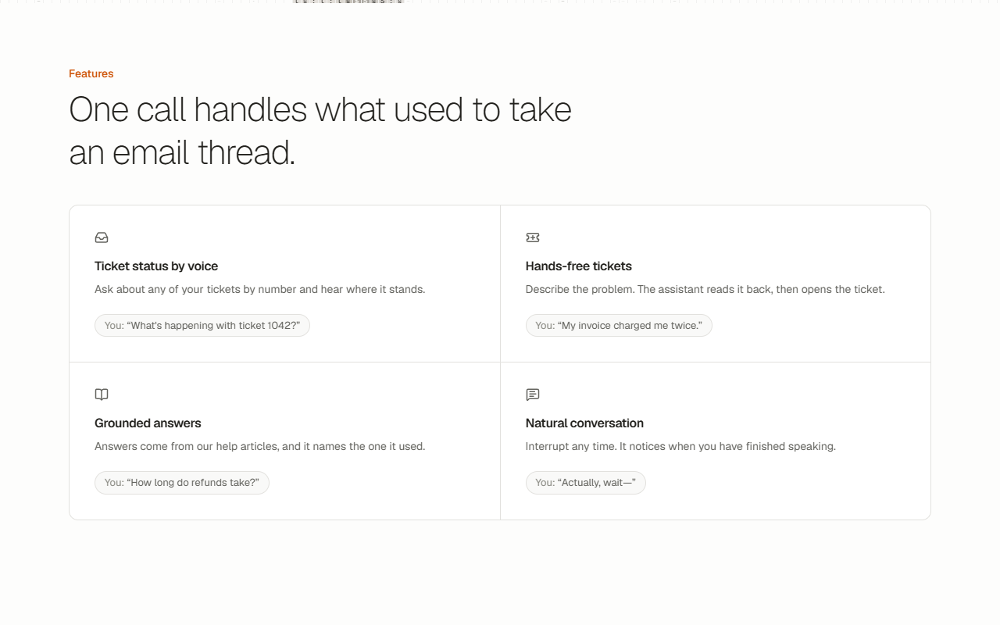
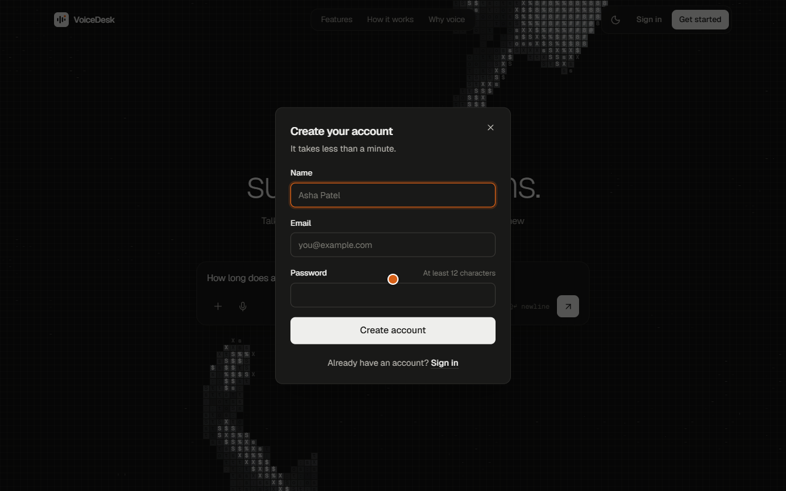
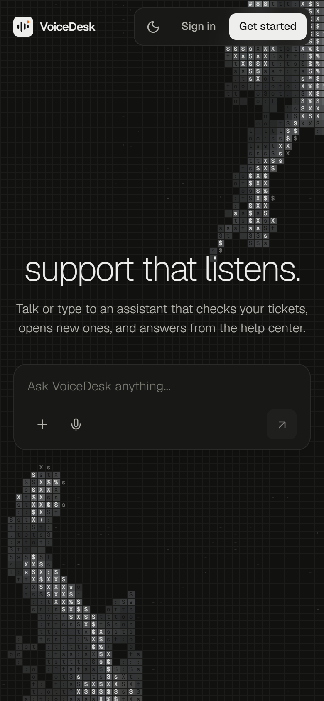
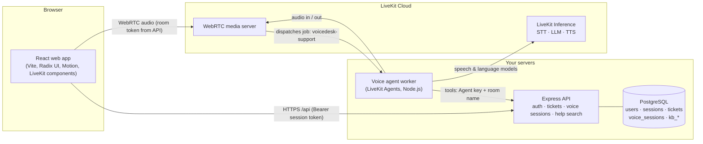

<div align="center">

# VoiceDesk

**Voice-first AI customer support.** Customers talk to an AI assistant in the browser. It checks their tickets, opens new ones, and answers how-to questions from the help center, and it only ever sees the caller's own data.

[](https://github.com/prince9118/voicedesk/actions/workflows/ci.yml)


[Demo](#demo) · [Highlights](#engineering-highlights) · [Architecture](#architecture) · [Quick start](#quick-start) · [Tests](#tests) · [Troubleshooting](#troubleshooting) · [Docs](#documentation)

</div>

## Demo

<a href="docs/media/voicedesk-demo.mp4">
  
</a>

<p align="center"><b>▶ <a href="docs/media/voicedesk-demo.mp4">Watch the full-quality video (MP4, 1:30)</a></b> · the preview above plays at 2.5× speed</p>

This is a **real call, not a mock-up.** The video was recorded end to end against the running stack (React app, API, PostgreSQL and the LiveKit voice agent). The spoken question is a synthesized voice played into the browser's microphone, so the recording is repeatable, but everything the assistant does is live: speech-to-text, the LLM, tool calls against the API, and text-to-speech.

| Time | What happens |
| --- | --- |
| 0:00 | Landing page: two hands from Michelangelo's *Creation of Adam*, drawn as ASCII, decode in. A visitor types a question. |
| 0:08 | The sign-up dialog opens. This visitor already has an account, so they switch to sign in. **The question is kept.** |
| 0:15 | The home screen opens with the question already in the composer. Switch to the light theme, open the ticket **History**. |
| 0:30 | Send. The assistant joins, greets, and **answers by voice from the help center**, naming the article it used. |
| 1:05 | Turn the microphone on and ask out loud about a ticket. The assistant **calls the tickets API as this user** and reads back the status. |
| 1:30 | End the call. |

The transcript from that recording, exactly as it appeared on screen:

> **Assistant:** Hello, this is the VoiceDesk assistant. How can I assist you today?<br>
> **Caller (typed):** How long does a refund take?<br>
> **Assistant:** According to our Refunds article, once a refund is approved, it goes to your original payment method the same day. Banks usually take 5 to 10 business days to show it on your statement, and PayPal refunds usually appear within 3 business days. Is there anything else you'd like to know?<br>
> **Caller (spoken):** Hi. Could you check the status of ticket number thirty two? Please?<br>
> **Assistant:** Ticket thirty two, about the wrong billing address on an invoice, is currently in progress. Would you like me to help with anything else about this ticket?

### Screenshots

| Home: type or talk (dark) | Live call: the hands light up with the voice |
| --- | --- |
|  |  |
| **Ticket history** | **Light theme** |
|  |  |
| **Landing page** | **Features** |
|  |  |
| **Sign up** | **Phone** |
|  |  |

## Engineering highlights

- **Real-time voice over WebRTC** (LiveKit Cloud): a speech-to-text → LLM → text-to-speech pipeline that can be interrupted mid-sentence and detects when the caller has finished speaking. Customers can also **type**: typed messages reach the same agent and are answered by voice.
- **Tool calling with real authorization.** The agent checks ticket status by spoken number, lists tickets, and creates tickets after reading them back. It acts *as the caller*: the API, not the LLM, enforces that a caller only ever sees their own data.
- **Grounded help-center answers (RAG)** over PostgreSQL full-text search, measured with an evaluation set, naming the source article and offering a ticket when it doesn't know.
- **A ticket REST API** with Zod validation, ownership rules, keyset pagination and idempotent creation.
- **Accounts:** scrypt password hashing and revocable sessions, with customer and support-agent roles.
- **Abuse and cost protection:** daily call limits per user and site-wide (made race-free with Postgres advisory locks), a maximum call length, and rate-limited sign-up and login. See [Usage limits](#usage-limits).
- **Operational care:** expired sessions are cleaned up hourly (without loosening the daily call limit, which a test proves), graceful shutdown has a 10-second deadline, and every call logs a summary with response latency, tool use, token usage and an estimated cost.
- **Production-ready deployment:** one Docker Compose stack behind Caddy with automatic HTTPS and a strict Content-Security-Policy.
- **A deliberate UI:** a single-prompt home screen with an animated ASCII backdrop driven by the real call audio, Radix UI primitives (accessible dialogs, tabs, menus and tooltips), light and dark themes with no flash on load, and reduced-motion support.
- **211 tests and CI:** 139 API integration tests against a real PostgreSQL, 24 agent tests and 48 frontend tests, all run on every push in GitHub Actions.

## Usage limits

A shared public link means anyone can sign up and start calls, and every call spends LiveKit credit. These limits keep cost bounded and slow down abuse.

| Limit | Default | What the user sees | Enforced in | Setting |
| --- | --- | --- | --- | --- |
| Voice calls per user | **3 per rolling 24 hours** | `429 VOICE_LIMIT_REACHED`: "You have used today's calls. You can start another in about N hour(s)." | [`voice.service.ts`](apps/api/src/voice/voice.service.ts) `startVoiceSession` | `VOICE_SESSIONS_PER_USER_PER_DAY` |
| Voice calls, whole site | **30 per rolling 24 hours** | `429 VOICE_CAPACITY_REACHED`: "Voice calls are at capacity for today." | [`voice.service.ts`](apps/api/src/voice/voice.service.ts) `startVoiceSession` | `VOICE_SESSIONS_PER_DAY` |
| Call length | **10 minutes** | The assistant says "We've reached the time limit for this call… Goodbye!" and ends the call | [`apps/agent/src/main.ts`](apps/agent/src/main.ts) call timer | `AGENT_MAX_CALL_MINUTES` (1 to 120) |
| Sign-ups per IP address | **5 per hour** | `429 RATE_LIMITED`: "Too many attempts. Try again in N minute(s)." | [`rate-limit.ts`](apps/api/src/rate-limit.ts), applied in [`auth.routes.ts`](apps/api/src/auth/auth.routes.ts) | `REGISTRATIONS_PER_IP_PER_HOUR` |
| Login attempts per IP address | **10 per 15 minutes** | `429 RATE_LIMITED`, same message | [`rate-limit.ts`](apps/api/src/rate-limit.ts), applied in [`auth.routes.ts`](apps/api/src/auth/auth.routes.ts) | `LOGIN_ATTEMPTS_PER_IP_PER_15_MIN` |

Every `429` response includes a `Retry-After` header. Change a limit by setting its variable in `apps/api/.env` (local) or `deploy/.env` (production); `AGENT_MAX_CALL_MINUTES` belongs to the agent (`apps/agent/.env` locally). All settings are validated at startup.

**How the limits are made reliable:**

- **Call limits are counted in PostgreSQL** (the `voice_sessions` table, over the last 24 hours), so restarting the server does not reset them.
- **Simultaneous requests cannot overshoot.** A per-user Postgres advisory lock makes "count, then start a call" atomic. A test fires 5 call requests at once and exactly 3 succeed.
- **IP addresses cannot be faked.** In production the API trusts exactly one proxy hop (`TRUST_PROXY=true`), and Caddy replaces any `X-Forwarded-For` sent by the client. Tested: sign-ups with a different fake IP on every request were still blocked after 5.
- **The call length cap was tested live** with a 1-minute setting: the agent ended the call on time.

**Known limitation:** the sign-up and login counters live in the API's memory. They reset when the API restarts and are not shared between instances. That is fine for one server; with several API instances they should move to Postgres or Redis.

Tests: [`apps/api/test/limits.test.ts`](apps/api/test/limits.test.ts).

## Architecture



The API owns all data and every authorization decision. The agent never touches the database; it calls the API with a service key plus the LiveKit room name, and the API acts as the user that room was created for. See [docs/architecture.md](docs/architecture.md) for the request flows.

## Tech stack

| Layer | Technology |
| --- | --- |
| Language | TypeScript (strict) everywhere |
| Frontend | React 19, Vite 7, Tailwind CSS 4, Radix UI primitives, Lucide icons, Motion, LiveKit React components |
| API | Node.js 24, Express 5, Zod 4 |
| Database | PostgreSQL 17 (Docker), Prisma 7 with the `pg` driver adapter |
| Voice | LiveKit Cloud (WebRTC), LiveKit Agents for Node.js |
| AI models | Via LiveKit Inference: Deepgram Nova-3 (STT), GPT-4.1 mini (LLM), Deepgram Aura-2 (TTS) |
| Retrieval | PostgreSQL full-text search, measured with an evaluation set |
| Logging | pino structured JSON logs with request IDs |
| Tests | Vitest, Supertest and a real PostgreSQL test database (API); Testing Library in jsdom (web); GitHub Actions CI |
| Deployment | Docker Compose, Caddy 2 (automatic HTTPS), one AWS Lightsail server (planned) |

## Repository layout

```text
voicedesk/
├── apps/
│   ├── api/          Express REST API, Prisma schema & migrations, help-center articles (+ Dockerfile)
│   ├── agent/        LiveKit voice agent and its tools (+ Dockerfile)
│   └── web/          React frontend (+ Dockerfile that builds it into a Caddy image)
├── deploy/           Caddyfile and the production .env template
├── .github/workflows/ CI: typecheck, build and tests for all three apps
├── docs/             Project documentation (start at docs/README.md)
├── docker-compose.yml       Local PostgreSQL for development
├── docker-compose.prod.yml  Full production stack on one server
├── LICENSE           MIT
└── package.json      npm workspaces
```

## Quick start

You need Node.js 24, Docker Desktop and a free [LiveKit Cloud](https://cloud.livekit.io) project. The full walkthrough is in [docs/getting-started.md](docs/getting-started.md).

```powershell
npm install
docker compose up -d --wait                      # PostgreSQL on localhost:5432

# Configure apps/api/.env and apps/agent/.env from their .env.example files, then:
cd apps/api;   npx prisma migrate deploy; npx prisma generate; npm run kb:ingest

# One terminal each:
cd apps/api;   npm run dev                        # http://localhost:4000
cd apps/agent; npm run dev                        # registers with LiveKit Cloud
cd apps/web;   npm run dev                        # http://localhost:5173
```

## Tests

**211 tests:** 139 API integration tests, 24 voice-agent tests and 48 web app tests. They run on every push in [GitHub Actions](.github/workflows/ci.yml).

```powershell
# Once: create the test database (the tests refuse to run against any database not ending in _test)
"CREATE DATABASE voicedesk_test;" | docker exec -i voicedesk-postgres psql -U voicedesk -d voicedesk

cd apps/api;   npm test      # real HTTP against a real PostgreSQL; migrations applied automatically
cd apps/agent; npm test      # the agent's API client (retries, timeouts, cancellation, idempotency) and call summary
cd apps/web;   npm test      # components and the API client in a simulated browser
```

The API tests cover sign-up and login, ticket ownership and field permissions, pagination, idempotency, database outages, voice sessions, the agent's delegated access, help-center search and the usage limits (including 5 simultaneous call requests, of which exactly 3 succeed), session cleanup and the shutdown deadline. The web tests cover the sign-in dialog, the message box, the ticket list and filters, and the question hand-off from the landing page.

## Useful scripts

Run these from `apps/api`:

| Command | What it does |
| --- | --- |
| `npm run kb:ingest` | Loads the help articles in `apps/api/knowledge/` into the database. Unchanged articles are skipped, so it is safe to run repeatedly. |
| `npm run kb:eval` | Measures search quality on 15 known questions: the right article first, and nothing returned for questions the help center cannot answer. Run it after editing articles. |
| `npm run livekit:check` | Confirms your LiveKit URL, key and secret are accepted by LiveKit Cloud. |
| `npm run user:set-role -- <email> <customer\|agent>` | Promotes a user to support agent (or back). Deliberately not an API endpoint. |

## Troubleshooting

| What you see | Cause and fix |
| --- | --- |
| Sign-in says **"Service temporarily unavailable, try again shortly"** | PostgreSQL is not running. Start Docker Desktop, then run `docker compose up -d --wait`. |
| The web app fails with **`Failed to resolve import "@fontsource…"`** (or any package) | Installed packages no longer match `package.json`, usually after switching branches or discarding changes. Run `npm install` at the repository root. |
| The call connects but the assistant never speaks | The agent is not running (`cd apps/agent; npm run dev`), or `LIVEKIT_AGENT_NAME` differs between `apps/api/.env` and `apps/agent/.env`. If the agent's log says **"runner initialization timed out"**, the machine was too busy to start the call's process in time; see the next row. |
| **"Microphone access is blocked"** | Allow the microphone from the icon in the address bar. Browsers only allow microphones on `https://` pages or `localhost`. |
| **"You have used today's calls"** | The limit is 3 calls per user per 24 hours. Raise `VOICE_SESSIONS_PER_USER_PER_DAY` in `apps/api/.env` for local testing. |
| The first answer is slow (about 9 to 15 seconds), or the call stays on "connecting" | `npm run dev` starts a fresh agent process for every call, which can time out on a busy machine. Run the agent in production mode instead, which keeps warm processes ready: `cd apps/agent; npx tsx src/main.ts start`. Once warm, an answer that needs a tool starts in about 2.5 seconds. |
| `npm test` in `apps/api` fails with **"Worker exited unexpectedly"** (seen on Windows, not on Linux CI) | A known intermittent crash of the test runner's worker process; see [Known issues](docs/roadmap.md#known-issues). Run the tests again: a crashed run is always reported as a failure, never as a pass. |
| The API exits at startup with **"Invalid environment configuration"** | A variable in `.env` is missing or malformed; the message names it. Compare with `.env.example`. |

## Deployment

The whole product runs on a single server with Docker:

```text
Internet ─HTTPS─▶ Caddy (automatic Let's Encrypt certificate, security headers)
                    ├─ /        → React app (static build)
                    └─ /api/*   → Express API ─▶ PostgreSQL (private network only)
                  Voice agent (production mode) ─▶ LiveKit Cloud
```

```bash
cp deploy/.env.example deploy/.env    # set DOMAIN, generated secrets, LiveKit keys
docker compose -f docker-compose.prod.yml --env-file deploy/.env up -d --build
```

On start, the API applies database migrations and loads the help articles. Only ports 80 and 443 are exposed. The site sends a strict Content-Security-Policy (scripts only from its own origin) and allows the microphone only for itself. HTTPS is required because browsers only allow microphone access on secure pages.

The stack has been tested end to end locally: HTTPS, sign-up, a live LiveKit call under the security policy with zero violations, the call limits, and IP-spoofing resistance of the rate limits. Hosting on AWS Lightsail (one 2 GB server, about $12 per month) is the next step.

## Documentation

| Document | What it covers |
| --- | --- |
| [Getting started](docs/getting-started.md) | Prerequisites, environment variables, running every part locally, scripts |
| [Architecture](docs/architecture.md) | Components, request flows, data model |
| [API reference](docs/api.md) | Every endpoint, request and response shapes, error codes |
| [Security](docs/security.md) | Authentication, authorization, agent delegation, secrets, privacy |
| [Voice agent](docs/voice-agent.md) | Pipeline, tools, models, costs, reliability |
| [Knowledge base](docs/knowledge-base.md) | Ingestion, retrieval, evaluation, known limits |
| [Design decisions](docs/decisions.md) | Key trade-offs, and what would change them |
| [Status and roadmap](docs/roadmap.md) | What is done, known issues, what is next |

## Author

Built by **[prince9118](https://github.com/prince9118)**: design, backend, voice agent, frontend and deployment.

## License

[MIT](LICENSE).
