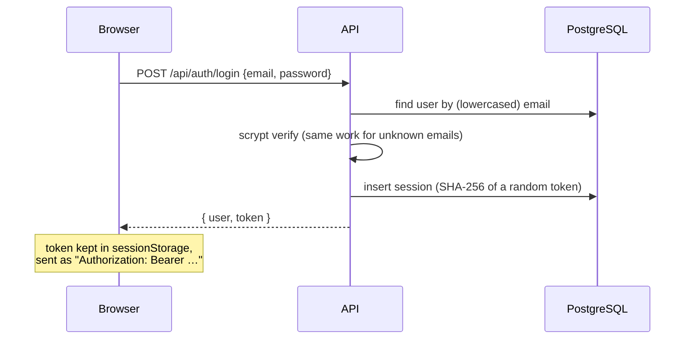
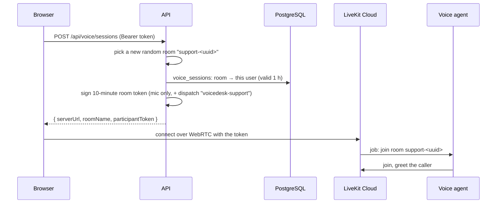
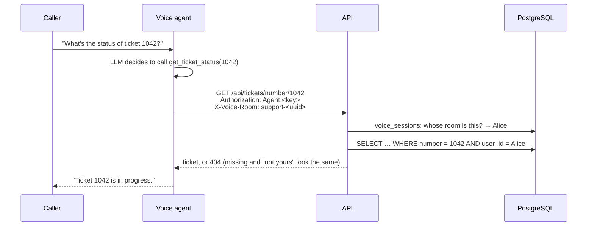
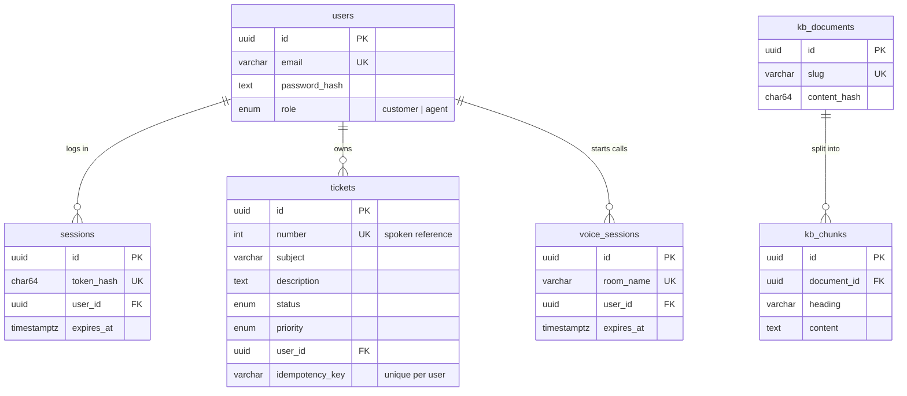

# Architecture

## Components

| Component | Location | Responsibility |
| --- | --- | --- |
| **Web app** | `apps/web` | Sign-in, ticket list, voice call UI. Talks to the API over HTTPS and to LiveKit over WebRTC. |
| **API** | `apps/api` | The only component that touches the database. Owns authentication, authorization, tickets, voice-session tokens and help-center search. |
| **Voice agent** | `apps/agent` | A worker that LiveKit dispatches into support calls. Runs speech-to-text → LLM → text-to-speech and calls the API through tools. |
| **PostgreSQL** | Docker | Users, sessions, tickets, voice sessions, help-center articles. |
| **LiveKit Cloud** | managed | WebRTC media routing (an SFU), agent dispatch, and LiveKit Inference for the AI models. |

### Why the agent does not use the database

Business rules and authorization live in one place: the API. If the agent queried the database directly, every rule (ownership, field permissions, validation) would need a second implementation that the LLM could be talked around. Instead the agent is just another API client with deliberately limited powers. See [security](security.md#how-the-voice-agent-acts-for-a-customer).

## Request flows

### Signing in



### Starting a voice call



The server chooses the room name. If the browser could choose it, a user could ask for a token to someone else's call.

### A tool call during the conversation



The LLM chooses *which tool to call*. The API decides *what data comes back*. The room name comes from LiveKit's job, never from the LLM.

### A help-center question

```mermaid
sequenceDiagram
  participant C as Caller
  participant G as Voice agent
  participant A as API
  C->>G: "My money hasn't come back"
  G->>G: LLM rewrites to keywords: "refund not received money back"
  G->>A: GET /api/kb/search?q=…
  A->>A: Postgres full-text search, keep scores ≥ 0.5
  A-->>G: passages with source article, or []
  G-->>C: "According to our Refunds article, …" / "I don't have that; shall I open a ticket?"
```

## Data model



Rules the database enforces itself, so a bug or a manual script cannot break them:

- Ticket `status`, `priority` and user `role` are Postgres enums.
- `email`, `token_hash`, `room_name`, ticket `number`, and `(user_id, idempotency_key)` are unique.
- Deleting a user deletes their sessions and voice sessions, but is **refused** while they still own tickets (`ON DELETE RESTRICT`), so support history cannot vanish by accident.
- Timestamps are `timestamptz(3)`: millisecond precision, matching JavaScript `Date`, which keyset pagination depends on.

## Inside the API

```text
request → httpLogger (request ID) → cors → express.json
        → router (auth middleware → parseInput (Zod) → policy check → store)
        → errorHandler (AppError → its status; DB outage → 503; anything else → 500)
```

| Layer | Example | Rule |
| --- | --- | --- |
| Routes | `tickets/ticket.routes.ts` | HTTP only: validate input, call the store, choose the status code |
| Policy | `tickets/ticket.policy.ts` | Who may see or change what; all ticket rules in one file |
| Store | `tickets/ticket.store.ts` | Database access; every query takes a required ownership scope |
| Config | `config.ts` | The only file that reads `process.env`, validated at startup |
| Errors | `errors.ts`, `error-handler.ts` | One place decides what an error response looks like |

Responses always have the shape `{ "data": … }` or `{ "error": { "code", "message", "details"? } }`.
